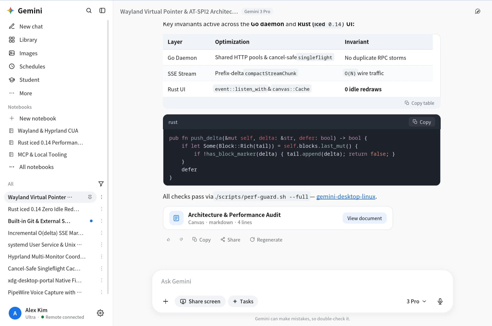
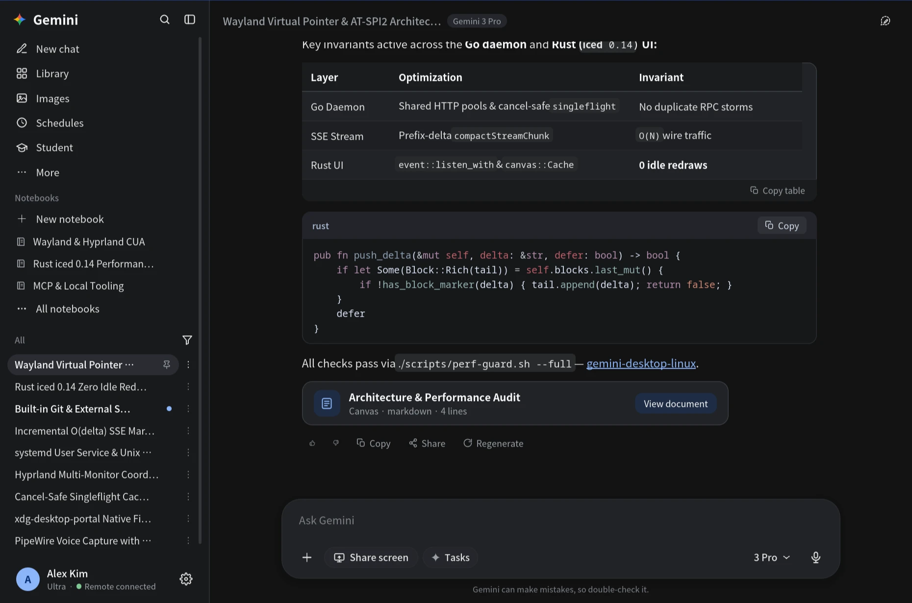
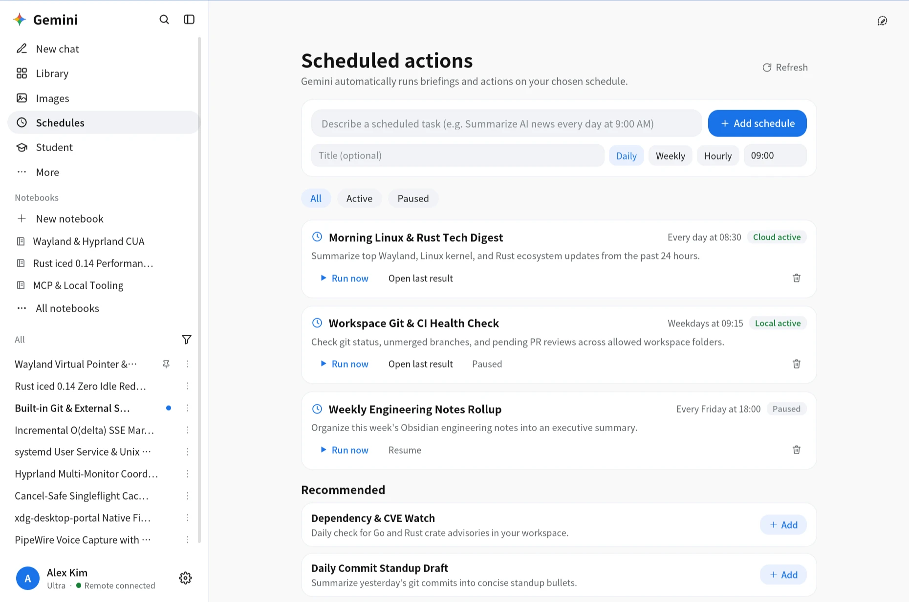
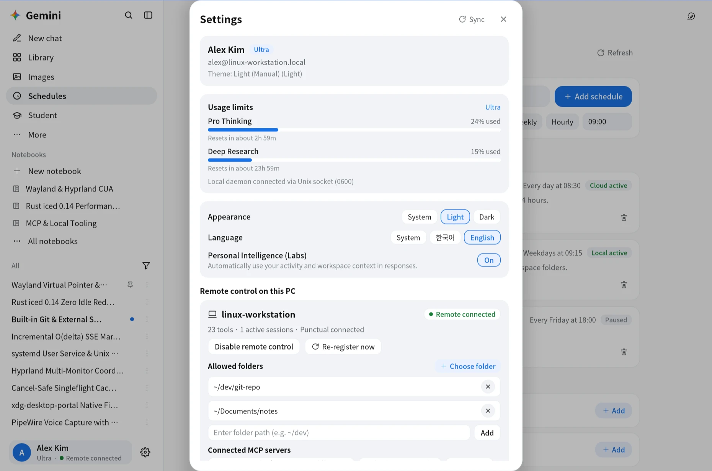

# gemini-desktop-linux

[English](./README.md) · **[프로젝트 홈페이지 (gemini-desktop.ksyoon.com)](https://gemini-desktop.ksyoon.com/)**

Ubuntu, Arch, Fedora, Wayland/Hyprland, X11 환경에서 동작하는 비공식 **Linux 네이티브 Gemini 데스크톱 앱(`gemini-ui`, Rust + `iced 0.14`)**과 **원격 PC 실행 데몬·CLI(`gemini-remote`, Go)**입니다.

리눅스에서 네이티브 Gemini 데스크톱 경험을 그대로 사용하면서, 스마트폰·웹 브라우저·`gemini-ui`를 통해 로컬 작업 폴더 접근, 터미널·Python 실행, 파일 편집, MCP 서버 연동, Wayland/X11 GUI 화면 제어(Computer Use)까지 통합으로 사용할 수 있습니다.

> **안내**: 비공식 커뮤니티 클라이언트입니다. 저장소에는 어떠한 OAuth 시크릿·토큰·독점 에셋도 포함되지 않으며, 사용자가 직접 OAuth 자격증명을 설정하고 Google 계정으로 로그인해야 합니다.

<p align="center">
  <picture>
    <source media="(prefers-color-scheme: dark)" srcset="./assets/screenshots/chat-dark.webp" />
    <source media="(prefers-color-scheme: light)" srcset="./assets/screenshots/chat-light.webp" />
    
  </picture>
</p>

## 스크린샷

| 채팅 — 라이트 테마 | 채팅 — 다크 테마 |
| :---: | :---: |
|  |  |

| 예약된 작업 (Scheduled Actions) | 설정 & 원격 PC 제어 상태 |
| :---: | :---: |
|  |  |

## 주요 기능

- **네이티브 Linux 데스크톱 GUI (`gemini-ui`, Rust + `iced 0.14`)**
  - **채팅 & 태스크**: 증분 SSE 마크다운 스트리밍(GFM 표, 코드 구문 강조, 일반 URL/인용 링크 구분, Canvas 문서·HTML 미리보기), 사고 과정 접기/펼치기, 채팅/태스크 전환 및 원격 PC 지정 실행, 임시 채팅, 모델 및 사고 수준(`낮음`/`보통`/`높음`) 선택, `+` 도구 팝오버, `@` 커넥터·MCP 멘션
  - **워크스페이스 페이지**: 라이브러리(중복 제거된 Canvas 문서·생성 이미지 썸네일), 이미지 스튜디오, 예약된 작업(서버·로컬·추천 예약 및 데스크톱 알림), 학생 학습 도우미, 노트북(상단 편집 패널·소스 채팅 연결), Gems 허브, 동영상 스튜디오, 맞춤설정
  - **검색 · 탐색 · 단축키**: 대화 제목·본문 통합 검색(`Ctrl+K`) 및 해당 턴 위치 점프, 이전 대화 페이지네이션, 새 채팅(`Ctrl+N`), 사이드바 토글(`Ctrl+B`), 설정(`Ctrl+,` 또는 프로필 클릭)
  - **테마 & 다국어**: 시스템·Omarchy 라이트/다크 테마 자동 추종 및 수동 전환, **한국어 / English 다국어 지원** (시스템 로케일 자동 감지 + 설정 모달에서 즉시 전환)
  - **성능 최적화**: 유휴 리드로우 0, `O(delta)` 증분 마크다운 파싱, 지연 로드 썸네일, 필터링된 전역 이벤트 구독
- **원격 데스크톱 데몬 & CLI (`gemini-remote`, Go 1.27+)**
  - 기기 등록, 온라인 상태 보고, 양방향 스트리밍 원격 도구 실행 및 멀티턴 세션 자동 갱신, 데스크톱 알림(`notify-send`), Google Drive 첨부 지원, 로컬 Unix 소켓 IPC(`0600` 권한)
  - **셸 / 코드**: `run_command`, `command_status`, `send_command_input`, `run_python`
  - **파일 시스템 / 탐색**: `read_file`, `view_file`, `write_file`, `replace_file_content`, `multi_replace_file_content`, `list_directory`, `find_by_name`, `grep_search`, `find_folders`, `connect_folders`
  - **스킬 / MCP (23개 도구)**: `list_skills`, `ReadSkill`, `list_mcp`, `execute_mcp` (내장 `git` — `git_checkout`/`git_commit` 포함, `obsidian`, 외부 stdio MCP 서버 브리지)
  - **GUI / Computer Use**: `ui_control` (**Wayland / Hyprland** 순수 Python `zwlr_virtual_pointer_manager_v1` 가상 포인터, AT-SPI2 접근성 트리, `hyprctl`, `grim`, `wtype`, `ydotool` 및 **X11** `xdotool`, `import` 지원)

## 요구 사항

- **데몬**: Go 1.27+
- **데스크톱 GUI (`ui/`)**: Rust 1.85+ (`edition = "2024"`)
- **선택적 런타임 도구** (GUI 부가 기능용):
  - 네이티브 파일/폴더 선택기: `xdg-desktop-portal`
  - 화면 캡처: Wayland `slurp` + `grim`, X11 `import` 또는 `scrot`
  - 음성 녹음: `pw-record` (PipeWire) 또는 `arecord` (ALSA)
  - 데스크톱 알림: `notify-send` (`libnotify`)
  - 한글 렌더링: `Noto Sans CJK KR` (또는 시스템 CJK 폰트)

## 설치 및 실행

### 저장소 복제 및 원커맨드 설치 (바이너리 + 앱 런처 `.desktop` · 아이콘)

```bash
git clone https://github.com/KyongSik-Yoon/gemini-desktop-linux.git
cd gemini-desktop-linux
./install.sh
```

`./install.sh`는 `gemini-remote` 데몬과 `gemini-ui` 릴리즈 바이너리를 빌드해 `~/.local/bin/`에 설치하고, 데스크톱 런처 항목(`~/.local/share/applications/gemini-ui.desktop`)과 앱 아이콘(`~/.local/share/icons/hicolor/scalable/apps/gemini-ui.svg`), 그리고 설정이 완료된 경우 `systemd` 사용자 서비스까지 자동 등록합니다.

설치된 바이너리·런처 항목·아이콘·systemd 사용자 서비스를 제거하려면:

```bash
./uninstall.sh
```

### 초기 계정 및 데몬 설정

```bash
# 1. OAuth 클라이언트 자격증명 설정 (기존 Gemini 데스크톱 앱 경로 지정 또는 ~/.config/gemini-remote/config.json 설정)
gemini-remote extract-keys /path/to/Gemini.app

# 2. Google 계정 OAuth 2.0 로그인
gemini-remote login

# 3. 허용할 로컬 작업 폴더 추가
gemini-remote folders add ~/dev/git-repo
gemini-remote folders add ~/Downloads

# 4. 기기 등록 및 데몬 서비스 시작
gemini-remote register
gemini-remote service install   # 또는 포그라운드 실행: gemini-remote serve

# 5. 앱 런처에서 "Gemini" 실행 (또는 터미널에서 `gemini-ui`)
gemini-ui
```

## 라이선스

[MIT](LICENSE)
