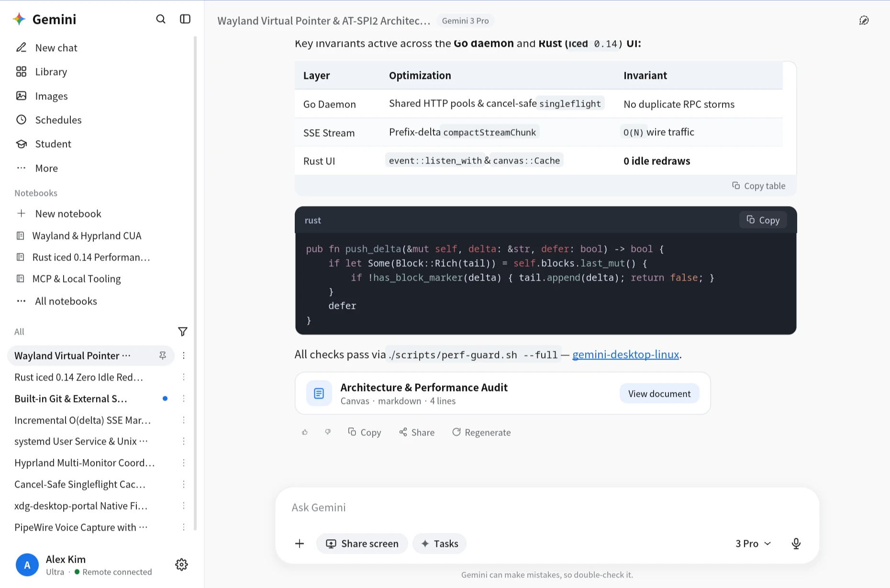
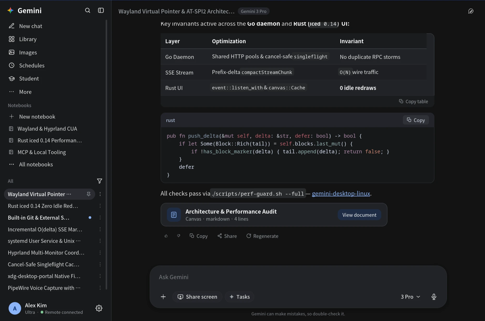
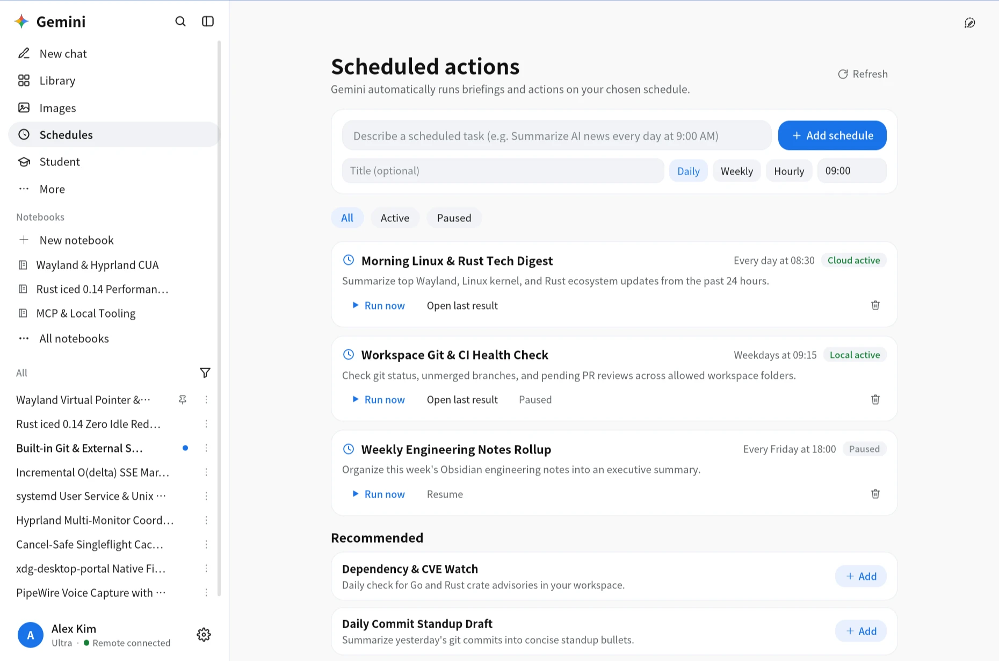
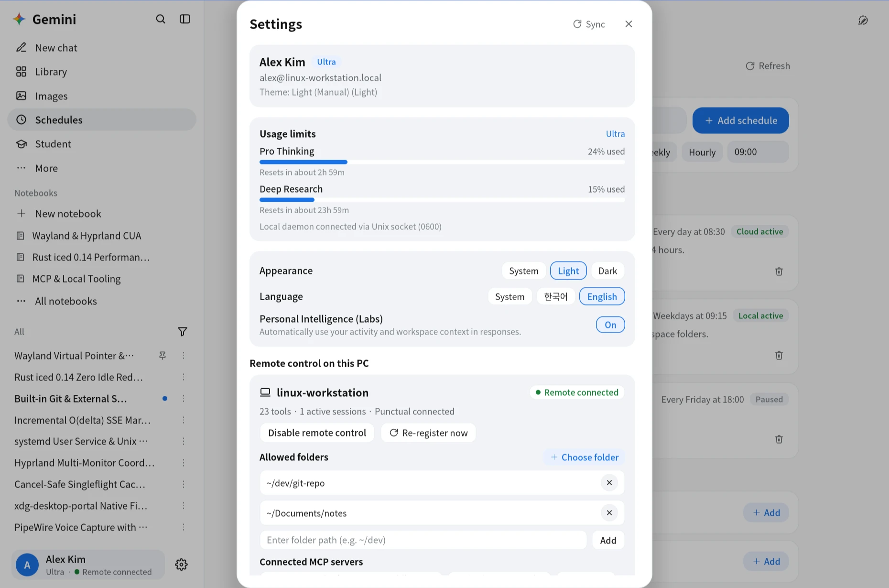

# gemini-desktop-linux

[한국어 문서 (Korean)](./README.ko.md) · **[Project Homepage (gemini-desktop.ksyoon.com)](https://gemini-desktop.ksyoon.com/)**

An unofficial **native Linux Gemini Desktop app (`gemini-ui`, Rust + `iced 0.14`)** and **remote PC execution daemon/CLI (`gemini-remote`, Go)** for Linux (Ubuntu, Arch, Fedora, Wayland/Hyprland, and X11).

Use the full Gemini Desktop experience natively on Linux — and connect your Linux PC or workstation to Gemini (Mobile, Web, and `gemini-ui`) for scoped local workspace access, shell/Python execution, MCP servers, and Wayland/X11 GUI Computer Use.

> **Disclaimer**: This is an unofficial community client using Gemini desktop protocols. No OAuth secrets, tokens, or proprietary assets are bundled — you must supply your own OAuth client credentials and sign in with your Google account.

<p align="center">
  <picture>
    <source media="(prefers-color-scheme: dark)" srcset="./assets/screenshots/chat-dark.webp" />
    <source media="(prefers-color-scheme: light)" srcset="./assets/screenshots/chat-light.webp" />
    
  </picture>
</p>

## Screenshots

| Chat — Light Theme | Chat — Dark Theme |
| :---: | :---: |
|  |  |

| Scheduled Actions | Settings & Remote PC Control |
| :---: | :---: |
|  |  |

## Key Features

- **Native Linux Desktop GUI (`gemini-ui`, Rust + `iced 0.14`)**
  - **Chat & Tasks**: Incremental SSE streaming Markdown (GFM tables, syntax-highlighted code blocks, clickable URLs vs. citation chips, Canvas document/HTML previews), collapsible Thinking view, Chat/Task mode with remote PC targeting, temporary chat, model & thinking-level picker (`Low` / `Medium` / `High`), `+` tools popover, and `@` connectors/MCP mentions
  - **Workspace Sections**: Library (deduplicated Canvas docs & generated image thumbnails), Image Studio, Scheduled Actions (cloud + local + recommended with desktop notifications), Student learning tools, Notebooks (top editor + source-to-chat binding), Gems hub, Video Studio, and Personalize
  - **Search, Navigation & Shortcuts**: Full title/body conversation search (`Ctrl+K`) with turn-jump scrolling, conversation pagination, new chat (`Ctrl+N`), sidebar toggle (`Ctrl+B`), and Settings (`Ctrl+,` or profile click)
  - **Appearance & Language**: Automatic system/Omarchy Light & Dark theme following (plus manual override) and **English / Korean localization** (auto-detected from system locale, switchable anytime in Settings)
  - **Efficiency**: Zero idle redraws, `O(delta)` streaming Markdown updates, lazy-loaded thumbnails, and event-filtered input handling
- **Remote Desktop Daemon & CLI (`gemini-remote`, Go 1.27+)**
  - Device registration, presence reporting, bidirectional streaming tool execution with automatic multi-turn session renewal, desktop notifications (`notify-send`), Google Drive attachment support, and `0600` Unix socket local IPC
  - **Shell / Code**: `run_command`, `command_status`, `send_command_input`, `run_python`
  - **File System & Search**: `read_file`, `view_file`, `write_file`, `replace_file_content`, `multi_replace_file_content`, `list_directory`, `find_by_name`, `grep_search`, `find_folders`, `connect_folders`
  - **Skills / MCP (23 tools)**: `list_skills`, `ReadSkill`, `list_mcp`, `execute_mcp` (built-in `git` including `git_checkout`/`git_commit`, `obsidian`, plus external stdio MCP server bridge)
  - **GUI / Computer Use**: `ui_control` for **Wayland / Hyprland** (pure-Python `zwlr_virtual_pointer_manager_v1` virtual pointer, AT-SPI2 accessibility tree, `hyprctl`, `grim`, `wtype`, `ydotool`) and **X11** (`xdotool`, `import`)

## Requirements

- **Daemon**: Go 1.27+
- **Desktop GUI (`ui/`)**: Rust 1.85+ (`edition = "2024"`)
- **Optional runtime tools** (for full GUI convenience):
  - Native file/folder picker: `xdg-desktop-portal`
  - Screen capture: `slurp` + `grim` (Wayland) or `import` / `scrot` (X11)
  - Voice input: `pw-record` (PipeWire) or `arecord` (ALSA)
  - Desktop notifications: `notify-send` (`libnotify`)
  - Korean text rendering: `Noto Sans CJK KR` (or any CJK sans-serif system font)

## Install & Quick Start

### Clone & One-Command Install (Binaries + Desktop Launcher & Icon)

```bash
git clone https://github.com/KyongSik-Yoon/gemini-desktop-linux.git
cd gemini-desktop-linux
./install.sh
```

`./install.sh` builds both `gemini-remote` and `gemini-ui` (release), installs them to `~/.local/bin/`, and registers the desktop launcher (`~/.local/share/applications/gemini-ui.desktop`), app icon (`~/.local/share/icons/hicolor/scalable/apps/gemini-ui.svg`), and `systemd` user service when configured.

To remove installed binaries, desktop entry, icon, and systemd user service:

```bash
./uninstall.sh
```

### Initial Account & Daemon Setup

```bash
# 1. Configure OAuth client credentials (from an existing Gemini desktop installation or ~/.config/gemini-remote/config.json)
gemini-remote extract-keys /path/to/Gemini.app

# 2. Sign in with Google OAuth 2.0
gemini-remote login

# 3. Allow local workspace folders
gemini-remote folders add ~/dev/git-repo
gemini-remote folders add ~/Downloads

# 4. Register your Linux machine and start the daemon
gemini-remote register
gemini-remote service install   # or `gemini-remote serve` in the foreground

# 5. Launch Gemini from your desktop app launcher (or run `gemini-ui`)
gemini-ui
```

## License

[MIT](LICENSE)
